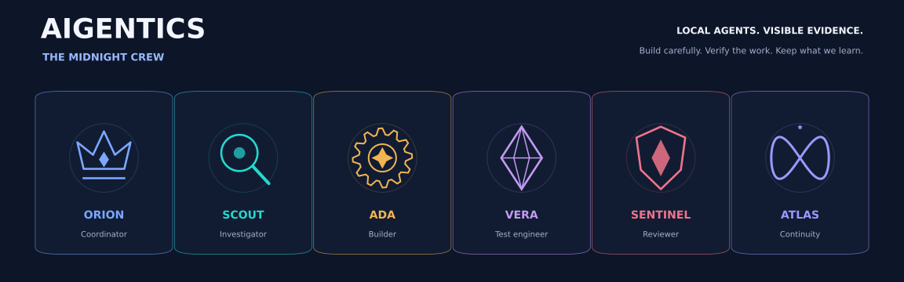
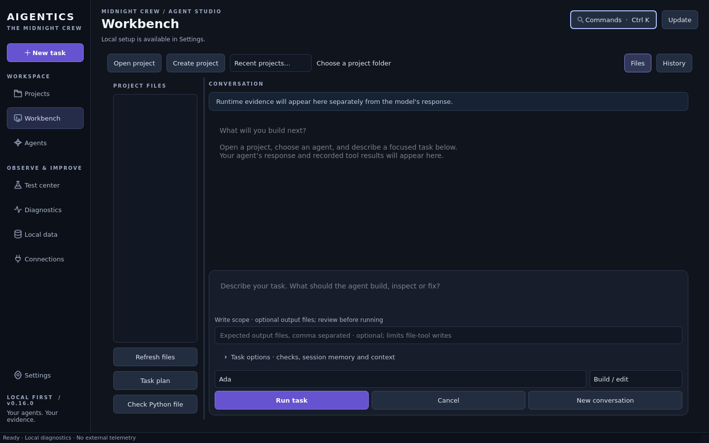
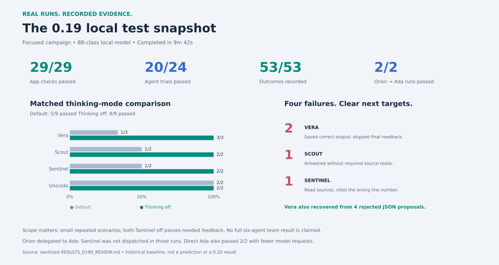
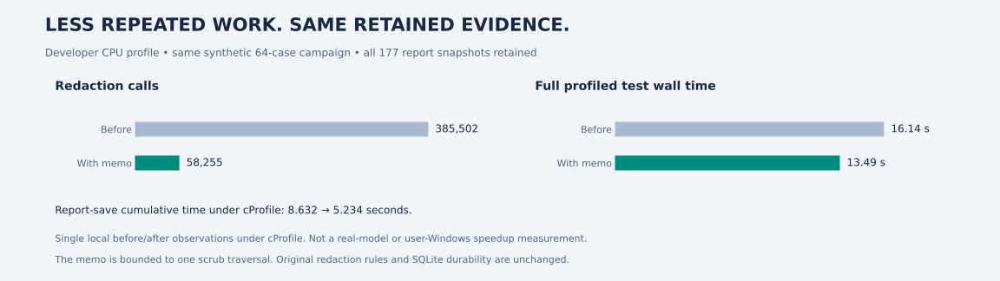
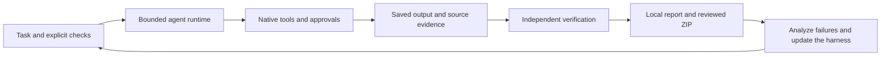

<p align="center">
  
</p>

<p align="center">
  <strong>A local-first desktop workshop for agents that do useful work—and leave evidence.</strong><br>
  Windows 10/11 · Python + PySide6 · Local Ollama · Reviewed changes · Repeatable evaluations
</p>

<p align="center">
  <a href="https://github.com/MeetleJuice/friendly-bassoon/releases/latest"><strong>Download the Windows installer</strong></a>
  · <a href="docs/maintenance/USER_TESTING.md">Testing guide</a>
  · <a href="docs/ARCHITECTURE.md">Architecture</a>
  · <a href="docs/maintenance/README.md">Engineering notebook</a>
</p>

## Build, inspect, verify, remember

**Aigentics Desktop** brings projects, coding agents, file tools, approvals and evaluation results into one native application. It runs with local Ollama models; a paid API is not required. Supported cloud profiles are available for explicitly configured use.

The application owns execution and permissions. An agent's claim that it finished is separate from evidence that a file was saved, read back and checked. Every update is an opportunity to understand a failure, strengthen the harness and measure the result.

This is an actively developed application. Individual specialists and a bounded Orion coordination pilot are implemented; a universally reliable autonomous team is the goal we are working toward.



*Native interface screenshot from the 0.16 UI milestone, rendered with synthetic project data. Later releases retain this layout and add functionality.*

## Meet the Midnight Crew

| Agent | Job | How the role helps |
| --- | --- | --- |
| **Orion** | Coordinator | Runs the opt-in serial Ada/Sentinel pilot with application-owned handoffs and shared budgets. |
| **Scout** | Investigator | Locates relevant code, reads competing sources and grounds findings in evidence. Read-only. |
| **Ada** | Builder | Makes focused changes, preserves unrelated work and verifies saved outputs. |
| **Vera** | Test engineer | Creates reproduction and boundary tests; distinguishes static checks from executed tests. |
| **Sentinel** | Reviewer | Checks actual code against requirements and reports concrete defects. Read-only. |
| **Atlas** | Continuity | Summarizes decisions, progress, uncertainties and next steps from project evidence. Writes handoff notes only when requested and approved. |

Roles share the selected model in controlled crew evaluations; their instructions and permissions differ. Saved agents remain editable. Historical generalist **George** cases remain in archived comparisons; they are not evidence of Orion's coordination performance. Atlas's role is not a guarantee of automatic or perfect memory.

The banner uses original lightweight geometric artwork. The character artwork shared in chat remains the visual direction; its original image files are not packaged here. See the [design record](docs/design/MIDNIGHT_CREW.md).

## Install once. Update from the app.

1. Download **`Aigentics-Setup-<version>.exe`** from [latest Release → Assets](https://github.com/MeetleJuice/friendly-bassoon/releases/latest).
2. Run the installer and leave **Create a desktop shortcut** selected. Python and application dependencies are bundled; Git and VS Code are not required.
3. Install/start **Ollama** separately. Aigentics discovers installed local models; choose one that supports native tools.
4. Create a disposable project, select an agent and try a small task. Inspect the proposed file diff before approving a write.

For future releases, click **Update**, download the verified installer, finish active work, then choose **Install & restart**. Updates use published GitHub Releases; a source change on `main` is not automatically an installed release. The installer backs up local records before upgrading and preserves the separate project/data locations. See [installation and update details](docs/INSTALLER.md).

**Desktop credentials:** optional `.env` / `.env.txt` discovery loads recognized keys into memory and creates matching provider profiles. It does not contact cloud models during discovery. Review or disable this under Settings. Never paste keys into agent tasks, reports or GitHub.

## What you can do now

| Area | Available capabilities |
| --- | --- |
| **Projects & Workbench** | Saved project roots/briefs, recent projects, file previews, project-scoped history, fresh or continued conversations. |
| **Tools & permissions** | List/read/search files, local project maps and bounded retrieval, approved revision-aware writes, separately approved bounded host commands. |
| **Verification** | Expected outputs, required source/tool evidence, readback after the latest write, Python static checks and explicit JSON proposal contracts. |
| **Context & continuity** | Local cited excerpts, hashes that detect changed files, opt-in saved redacted session content and durable project/task records. |
| **Agent coordination** | Typed Orion → Ada → optional Sentinel pilot, serial child sessions, shared request/output/time limits and no automatic action replay. |
| **Testing & diagnostics** | Packaged offline checks, isolated live local-model campaigns, bounded corrective feedback and separate failure/incomplete outcomes. |
| **Local data & sharing** | SQLite history, retention controls, backups and reviewed diagnostic ZIPs with an integrity manifest. Nothing uploads automatically. |

Use **Ctrl K** for navigation search. **Ctrl Enter** runs a task while the Workbench task field is focused. **Files**, **History** and **Task options** reveal the extra evidence when you need it.

Tools are registered and permission-filtered by the application. A text block that resembles a tool call does not execute. Approved host commands are **not a security sandbox**; keep backups and use version control for real projects.

## What our local tests show

The [latest completed 0.20 run](docs/maintenance/RESULTS_0200_REVIEW.md) recorded **30/30 app checks and 30/32 agent trials passed**, with all62outcomes retained in12m38s. Both required Orion→Ada→Sentinel inspection trials passed. The retained24case core passed23/24versus20/24in0.19; small cross-version samples do not establish a causal reliability gain. Remaining failures are repeated rejected JSON proposals and a correct searched answer without required file reads. The new verification-only phase did not trigger in these live trials; its installed synthetic check passed.

### Historical 0.19 baseline



This **0.19 baseline** came from a complete, validated diagnostic ZIP using an 8B-class local model. The [sanitized review](docs/maintenance/RESULTS_0190_REVIEW.md) explains the conditions, counters and limitations.

- **Orion delegated to Ada successfully in both managed runs.** Direct Ada also passed both runs with fewer requests. Sentinel was not dispatched in these trials, so they do not prove the review handoff or a team quality advantage.
- **Vera corrected rejected JSON proposals in all three thinking-off runs.** Failed calls stayed recorded; success required a permitted saved output, current readback and strict content checks.
- **Four failures exposed precise gaps:** two omitted final readbacks, one missing source inspection and one wrong line citation.
- **Thinking off was stronger in these narrow comparisons.** Repeated scenarios, a small sample and feedback-dependent successes limit the conclusion. This is not a universal model ranking, a 9B result or evidence of model training.

### The 0.20 reliability update

The [0.20 release](https://github.com/MeetleJuice/friendly-bassoon/releases/tag/v0.20.0) adds final-readback recovery, stronger source/citation cases, an actual required reviewer canary and consistent direct/managed budget telemetry. Recommended testing now records 30 app checks plus 32 model trial slots: 62 outcomes. Historical manifests and failures stay intact; changed conditions receive a new benchmark identity. See the [verified installer receipt](docs/maintenance/RELEASE_0200_VERIFIED.json) and [release notes](docs/RELEASE_NOTES.md). Real model improvements remain subject to the next local run.

<details>
<summary>Developer profiling: less repeated report processing, with the evidence retained</summary>

A bounded per-traversal redaction memo reduced repeated redactor calls in one synthetic 64-case campaign from **385,502 to 58,255**; the profiled test's observed wall time was **16.14 → 13.49 seconds**, with all **177 report snapshots retained**. These are single local developer observations under cProfile, not a live-model or user-Windows speedup measurement. Original redaction rules and SQLite durability are unchanged. See the [profile provenance](docs/design/README_ASSETS.md).



</details>

MCP connections, phone/email control and broader autonomous orchestration are future directions, not current integrations. Our near-term priority is dependable local execution with measurable evidence.

## Help improve the app with one test run

1. Keep Ollama running and use the same selected local model when comparing releases.
2. After an update, allow the queued recommended campaign to finish once, or open **Test center** and click **Go**. Live model tests use disposable files, not your project.
3. Choose **Review / save diagnostic ZIP**, inspect the preview, approve local saving and save the archive.
4. Attach the ZIP when requesting analysis. Partial/stopped results are useful too; do not rerun solely to get green results.

No GitHub token or issue submission is required for this ZIP workflow. The suite does not automatically run cloud generation or API-key tests. Optional **Test APIs** is separate: at most one model-list request per unique configured connection, with no generation prompt.

The suite records timing, known model usage, tool outcomes, verification, correction attempts and missing/interrupted results. Application checks and live-model trials prove different things. A larger suite or more retained data is not itself proof that agents improved.



## Your data stays under your control

Metadata is the default. **Save redacted session content** is optional and may retain project code for later resume. Resume uses stored conversation context; it does not replay prior tool actions or restore a paused program counter.

Public report/ZIP exports exclude project text, transcripts, private paths and credential values through a sharing allowlist. You review and approve the export. Model names are optional where offered. Local retention controls and deletion are available in **Local data**; copies you export or back up remain your responsibility.

The original Desktop key file is not copied into history. OS credential storage is available without a plaintext fallback. The app data directory, installation binaries and your coding projects have separate roles—use **Local data → Open local data folder** to locate the actual records. See the [data contract](docs/DATA.md) and [diagnostic details](docs/DIAGNOSTICS.md).

## Develop and contribute

Use Python **3.12** where possible; supported versions are 3.11–3.13. Read [AGENTS.md](AGENTS.md) and the [maintenance index](docs/maintenance/README.md) before changing runtime or evaluation behavior. Coordinate independent work through small branches/PRs and explicit ownership; never commit raw user diagnostics or secrets.

**Windows / PowerShell**

```powershell
py -3.12 -m venv .venv
.\.venv\Scripts\python.exe -m pip install -e ".[dev]"
.\.venv\Scripts\python.exe -m aigentics
.\.venv\Scripts\python.exe -m pytest -q
.\.venv\Scripts\python.exe -m ruff check aigentics tests scripts
```

**Cloud / Linux**

```bash
python -m venv .venv
.venv/bin/python -m pip install -r requirements-linux.lock
.venv/bin/python -m pip install --no-deps -e .
QT_QPA_PLATFORM=offscreen .venv/bin/python -m pytest -q
.venv/bin/ruff check aigentics tests scripts
```

The Linux lockfile is not a Windows lockfile. Normal automated tests use synthetic fixtures and require no GPU, model, network service or API key. Real-model acceptance is a separate test layer. A cloud shell does not display a window on your Windows PC.

Windows releases must pass the full source workflow, actual installation/shortcut/packaged diagnostics and previous-release upgrade preservation. Promotion publishes that exact verified installer without rebuilding it. [Actions](https://github.com/MeetleJuice/friendly-bassoon/actions/workflows/windows-release.yml) and the [release checklist](docs/maintenance/RELEASE_CHECKLIST.md) show the delivery process.

---

**Project memory:** [Engineering log](docs/ENGINEERING_LOG.md) · [Maintenance workspace](docs/maintenance/README.md) · [Architecture](docs/ARCHITECTURE.md) · [Verification](docs/VERIFICATION.md) · [Design direction](docs/design/MIDNIGHT_CREW.md)
